# Харнесс OCR

Харнесс OCR извлекает поля русскоязычных документов через связку DB/CTC, Xiaomi-OCR-0 и Qwen. Каждое значение связано с исходным фрагментом; модель выбирает кандидатов и области перечитывания, а сервер проверяет происхождение, роль, формат и применимость политики.

**Статус: инженерный release candidate с закрытым автоматическим принятием.** Целевая машина — Linux, Docker и RTX PRO 5000 Blackwell 48 GB. Готовность программного конвейера, сборки контейнера и качества OCR проверяется раздельно: [матрица готовности](docs/readiness.md). До GPU-приёмки и независимой квалификации документов движок нельзя считать готовым к промышленному автозаполнению.

## Установка на машине коллеги

```bash
git clone https://github.com/VasilyKolbenev/Harness_OCR.git
cd Harness_OCR
export HARNESS_API_TOKEN="$(python3 -c 'import secrets; print(secrets.token_urlsafe(32))')"
export HARNESS_REVIEW_TOKEN="$(python3 -c 'import secrets; print(secrets.token_urlsafe(32))')"
mkdir -p models
docker compose build --pull
docker compose run --rm --no-deps --user "$(id -u):$(id -g)" \
  -v "$PWD/models:/models:rw" --entrypoint python ocr \
  -m harness_ocr.cli prepare-models --models /models --download
docker compose up -d
docker compose exec ocr python scripts/doctor.py --models /models \
  --base-url http://127.0.0.1:8080 --output /reports/doctor-001.json
```

Полная инструкция с требованиями к драйверу, проверками HTTP/MCP, review, отмены и сравнением моделей: [README_LINUX_GPU.txt](README_LINUX_GPU.txt). Токены должны различаться и сохраняться в вашем хранилище секретов. Модели скачиваются отдельной явной командой с проверкой ревизий и SHA; в репозитории весов нет.

## Рабочий конвейер

```mermaid
flowchart LR
    C[Клиент услуги или MCP] --> A[HTTP и непрозрачный artifact ID]
    A --> J[Постоянная очередь SQLite]
    J --> W[Единственный владелец устройства]
    W --> I[Изолированное декодирование]
    I --> O[DB/CTC и Xiaomi]
    I --> N[МЧД 003: официальный XSD и точные XML пути]
    N --> S[Повторная проверка по исходным байтам]
    S --> R
    O --> G[Наблюдения, геометрия, кандидаты и роли]
    G --> Q[Qwen 0.8B или 4B]
    Q --> R[Проверка ID и источников]
    R --> V[Валидаторы и политика документа]
    R --> B[Ограниченное перечитывание]
    B --> O
    R --> P[Слепое чтение разрешённых ROI через Qwen vision]
    P --> D[Дословное сравнение и сохранение расхождений]
    D --> V
    V --> F[Результат или review]
    F --> H[Авторизованная правка с CAS ревизией]
    H --> V
```



API и offline benchmark используют одно ядро. Нейронные вызовы выполняются последовательно в отдельном процессе: отмена и таймаут завершают его, новый вызов получает чистое состояние. Общая блокировка устройства защищает API и benchmark при разных каталогах состояния. В Compose она хранится в общем volume; независимые развёртывания должны использовать один `HARNESS_LOCK_DIR` для одного GPU.

Формат ответа Qwen ограничен при декодировании JSONSchema, построенной сервером из разрешённых полей, кандидатов и областей. Это не исправление распознанного текста: проверки буквальной поддержки, ролей и конфликтов выполняются после генерации. Ограничитель работает без небезопасного перехода к свободной генерации; состояние parser создаётся заново, а preprocessing токенизатора переиспользуется. В трассу входят SHA схемы и фактически использованные EOS IDs.

Версии документа, утверждения, зависимости, задания и трассы сохраняются в SQLite. Противоречие отзывает зависимые автоматические выводы. Модель не отменяет правку человека. Машинная квалификация риска не переносится автоматически на новое значение, введённое оператором.

[Компоненты и взаимодействие](docs/architecture.md) · [Диаграмма последовательности](docs/sequence.mmd)

## Компоненты F01–F09

| ID | Назначение | Использование |
|---|---|---|
| F01 | Наблюдения, утверждения, зависимости и ревизии | Рабочий конвейер, конфликты и review |
| F02 | Трассы и повтор отдельной стадии | Детерминированный replay без повторного OCR |
| F03 | Компилятор профилей | Единая схема полей, ролей, кандидатов и MCP/review-проекция |
| F04 | Слепой экзамен верификатору | Настоящие text/vision адаптеры; эталон только у scorer |
| F05 | Минимизация воспроизводимой ошибки | Уменьшение сохранённого графа с тем же дефектом |
| F06 | Случайный аудит и дрейф | Опубликованная выдача, вероятность отбора и карантин |
| F07 | Утверждённые стратегии чтения | Версии, область действия, отрицательные результаты и отзыв |
| F08 | Риск всего документа | Раздельные calibration/qualification/test и серверная политика |
| F09 | Разделение оптики и понимания | DEV oracle 2×2, изолированный от production API |

Границы реализации каждого компонента перечислены в матрице готовности. Неподдерживаемые директивы стратегии вызывают `review`, а не исполняются приблизительно. Исследовательские инструменты не запускаются на каждом пользовательском документе: [контракты исследований](src/harness_ocr/research/README.txt), [контроллеры качества](src/harness_ocr/control/README.txt).

## Контракты документов

В пакет включены 10 деклараций с 96 полями: паспорт РФ, свидетельство о рождении, СНИЛС, доверенность, паспорт самоходной машины, свидетельство регистрации техники, платёжное извещение, банковское подтверждение оплаты, договор на образование и полис ОМС.

Это контракты извлечения. Реальное покрытие макетов и качество по полям требуют отдельного корпуса документов. Неизвестная применимость поля остаётся неизвестной; отсутствие OCR-строки не означает, что поле не требуется. Условия можно зафиксировать только версионированной серверной конфигурацией для конкретного контракта услуги.

```bash
python -m harness_ocr.cli profiles
```

`raw_value` сохраняет исходное чтение. Нормализация разрешена только явно указанным преобразованием. Проверка формата, контрольного числа и роли не доказывает подлинность документа, факт оплаты или право на услугу.

Семь составных полей имеют исполняемый `typed-fields-v1`: реквизиты сторон доверенности, идентификаторы техники, строки владельцев, типы счетов и ЕНП. Вложенные значения содержат буквальное чтение, вид, роль, версию и ссылки на источники; таблицы сохраняют порядок и повторяющиеся строки. [Границы контрактов](docs/typed-field-contracts.md) включают явные `not_checked` для неизвестных редакций, форматов изготовителей и пока не квалифицированного банковского ключа.

Зарегистрирован native-адаптер обычной ненотариальной МЧД 003/EMCHD_1. Он использует оригинальный закреплённый XSD, точные пути и атрибуты; перед записью состояния сервер повторяет отображение по исходным байтам. Полные списки сторон и ограничений сохраняются. Проверка подписи, отзыва и юридических полномочий требует отдельного доверенного контура: [формат и область адаптера](docs/mchd_native.md).

В Compose включён ограниченный визуальный verifier: до двух исходных ROI после перечитываний. Qwen видит только пиксели и позиционные ID, затем сервер сравнивает полное чтение дословно. Расхождение или неполный охват сохраняют `review`; значение не заменяется по догадке. Использование той же Qwen для выбора и vision не считается независимым подтверждением. Для прямого запуска задайте `HARNESS_VISUAL_VERIFIER=1`: [контракт и проверка на RTX](docs/visual-verifier.md).

## Проверки и сравнение моделей

```bash
python3 -m venv .venv
. .venv/bin/activate
python -m pip install '.[inference,mcp]'
python -m pip check
python -m unittest discover -s tests -v
```

Эти тесты проверяют программные контракты, локальные HTTP/MCP и управление процессами; они не скачивают и не запускают нейромодели. GitHub Actions выполняет чистую Linux-установку и тесты; на `main` отдельно собирает CUDA-контейнер и проверяет импорты. Успешная сборка контейнера ещё не подтверждает GPU-инференс.

GPU-сравнение использует A0 (оптика и детерминированный сборщик), A1 (те же наблюдения + Qwen 0.8B base), A3 (те же наблюдения + Qwen 4B base), A4 (4B и ограниченное перечитывание). Runner фиксирует протокол до вычислений и проверяет общие наблюдения по SHA. Варианты одного исходника группируются по `original_id`. Эталон получает только scorer.

В этих четырёх ветвях vision выключен явно, чтобы A0 оставался детерминированным baseline. Визуальная проверка измеряется отдельно слепым F04; native XML не принимается в сравнительный оптический бенчмарк.

Математический weight patch не применяется скрыто к OCR или 4B: это отдельный фактор, для которого нужны проверка переноса и OCR-эксперимент. Версии исходных моделей: [model_lock.json](src/harness_ocr/data/model_lock.json).

## Граница первой поставки

Первое развёртывание однопользовательское, с одним GPU. Внешние SSO, TLS, изоляция организаций, резервирование и сроки хранения документов относятся к инфраструктуре. Обычный API не предоставляет модели доступ к произвольным путям, HTTP-адресам, весам или управлению квалификацией.

Generic XML сохраняется как диагностическое структурное наблюдение и не наследует квалификацию зарегистрированной МЧД. Неподдерживаемые варианты схемы и составных полей возвращают явную причину отказа или `not_checked`/`review`.

Лицензирование собственного кода: [LICENSE.txt](LICENSE.txt). Сторонние компоненты: [THIRD_PARTY_NOTICES.txt](THIRD_PARTY_NOTICES.txt).
