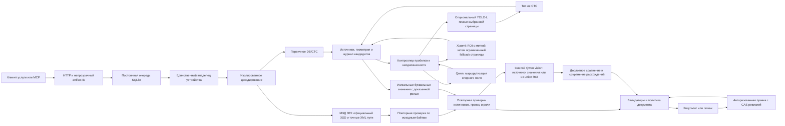

# Харнесс OCR

Харнесс OCR извлекает поля русскоязычных документов через связку DB/CTC, Xiaomi-OCR-0 и Qwen. В 0.1.0rc6 чтение управляется нехваткой доказательств: сначала дешёвая оптика, затем адресное перечитывание и при необходимости дополнительный детектор. Каждое значение связано с исходным фрагментом; сервер проверяет происхождение, границы, роль, формат и применимость политики.

## Запуск из main на GPU

```bash
git clone --branch main https://github.com/VasilyKolbenev/Harness_OCR.git
cd Harness_OCR
bash scripts/gpu_handoff.sh --input /absolute/path/to/documents --profile D07 --output "$PWD/reports/run-001"
```

Нужны Linux x86_64, Docker Compose, NVIDIA Container Toolkit и Python3.12+ на хосте. D07 — платёжное извещение; для других документов выберите явный профиль из [каталога10профилей/96полей](docs/supported-documents.md). Для смешанной пачки используйте manifest. Точные требования и форматы: [README_LINUX_GPU.txt](README_LINUX_GPU.txt), [инструкция коллеге](docs/colleague-handoff.md).

Команда собирает CUDA-образ с YOLO, фиксирует его image ID, загружает закреплённые веса, проверяет их SHA, выполняет настоящий GPU smoke, затем последовательно сравнивает **Qwen0.8B/4B × DB/DB+YOLO-L**. Во всех четырёх вариантах сохраняются Xiaomi, ограниченное перечитывание, визуальный verifier и строгие проверки. `--include-yolo-x` добавляет ещё два варианта. По умолчанию сравнение ограничено3часами; сборка, загрузка и smoke имеют отдельные бюджеты. Неполученные результаты отмечаются явно, автоматического повторного запуска нет.

Прислать команде **`reports/run-001/RETURN_TO_TEAM.zip`**: безопасные HTML/CSV/JSON без документов, распознанных значений, gold, исходных имён, промптов и приватных логов. Полные результаты и трассы остаются локально. Архив формируется и при ошибке. Права исходных файлов не меняются; документы и модели при инференсе монтируются read-only, сеть отключена. Веса и документы не включены в исходный пакет.

Без эталонов отчёт измеряет выполнение, покрытие, review, скорость и ресурсы. Для точности добавляется отдельный `--gold` с дословными строковыми эталонами; значения не поступают моделям. Goldv1 не оценивает составные typed-поля. Техническое завершение, наличие прочитанного значения, валидность формата и точность — разные показатели. `review` остаётся штатным результатом. Этот запуск проверяет новое adaptive-ядро, а не прежний frozen-optics benchmark.

HTTP/MCP остаются дополнительным режимом того же ядра. Перед сравнением работающий OCR нужно штатно остановить. Все запуски на одной карте используют общий внешний volume `harness-ocr-device-locks`; команда передачи создаёт и готовит его сама. Для ручного API-развёртывания следуйте [инструкции](docs/deployment-readiness.md). Временные измерительные контейнеры используют host PID только для атрибуции NVML; основной API изолирован.

## Статус и ограничения

**Статус: 0.1.0rc6, инженерный release candidate с закрытым автоматическим принятием.** Целевая машина — Linux, Docker и RTX PRO 5000 Blackwell 48 GB. Качество нового адаптивного тракта и фактический GPU-инференс ещё не квалифицированы. Готовность программного конвейера, сборки контейнера и качества OCR проверяется раздельно: [матрица готовности](docs/readiness.md). До GPU-приёмки и независимой квалификации документов движок нельзя считать готовым к промышленному автозаполнению.

CPU-проверка нового ядра завершена: на пяти документах прежний DB / новое ядро с DB / новое ядро с rescue YOLO-L дали 6 / 8 / 9 точных полей из 19. Это небольшой набор, преимущественно вымышленные документы. Все оцениваемые поля не удалось точно извлечь ни на одном документе. [Измерения, вклад YOLO и ограничения](docs/rc5-quality-findings.md) объясняют, почему улучшение ещё не означает готовность к production.

В именах отдельно отмечается неопределённость при смешении похожих латинских и кириллических букв внутри слова. Она требует review и не переписывает raw. Форматный `pass` остаётся отдельным результатом; сигнал качества не объявляет строку ошибочной и не нормализует её.

## Рабочий конвейер



API и offline benchmark используют одно ядро. Нейронные вызовы выполняются последовательно в отдельном процессе: отмена и таймаут завершают его, новый вызов получает чистое состояние. Общая блокировка устройства защищает API и benchmark при разных каталогах состояния. В Compose она хранится в общем внешнем volume; независимые развёртывания должны монтировать один физический каталог блокировок для одного GPU.

Адаптивный контроллер сохраняет наблюдения и версии журнала кандидатов, но фиксирует итоговые утверждения после ограниченных чтений. Единственное полное значение с доказанной связью с меткой выбирается детерминированно. Qwen вызывается для маршрутизации подлинной неоднозначности в окне одного поля и для слепого визуального чтения. Его предпочтение не удаляет противоречащий источник и не исправляет невалидное значение.

Xiaomi читает выбранную область вместе с контекстом метки; полное чтение страницы оставлено ограниченным fallback. Опциональный YOLO-L ищет дополнительные области на выбранной странице, когда не хватает оптического доказательства или оборваны границы. Его области читает тот же CTC: это дополнительная геометрия, а не независимый распознаватель.

Формат ответа Qwen ограничен при декодировании закрытой JSONSchema, построенной сервером из разрешённых полей, кандидатов и областей. Повторы одного поля запрещены; ответ `unreadable` допускает только пустой литерал. Проверки буквальной поддержки, ролей и конфликтов выполняются после генерации. Ограничитель работает без перехода к свободной генерации; состояние parser создаётся заново. В трассу входят SHA схемы и фактически использованные EOS IDs.

Версии документа, утверждения, зависимости, задания и трассы сохраняются в SQLite. Противоречие отзывает зависимые автоматические выводы. Модель не отменяет правку человека. Машинная квалификация риска не переносится автоматически на новое значение, введённое оператором.

[Компоненты и взаимодействие](docs/architecture.md) · [Диаграмма последовательности](docs/sequence.mmd)

## Компоненты F01–F09

| ID | Назначение | Использование |
|---|---|---|
| F01 | Наблюдения, утверждения, зависимости и ревизии | Рабочий конвейер, конфликты и review |
| F02 | Трассы и повтор отдельной стадии | Детерминированный replay без повторного OCR |
| F03 | Компилятор профилей | Единая схема полей, ролей, кандидатов и MCP/review-проекция |
| F04 | Слепой экзамен верификатору | Настоящие text/vision адаптеры; эталон только у scorer |
| F05 | Минимизация воспроизводимой ошибки | Уменьшение сохранённого графа с тем же дефектом |
| F06 | Случайный аудит и дрейф | Опубликованная выдача, вероятность отбора и карантин |
| F07 | Утверждённые стратегии чтения | Версии, область действия, отрицательные результаты и отзыв |
| F08 | Риск всего документа | Раздельные calibration/qualification/test и серверная политика |
| F09 | Разделение оптики и понимания | DEV oracle 2×2, изолированный от production API |

Границы реализации каждого компонента перечислены в матрице готовности. Неподдерживаемые директивы стратегии вызывают `review`, а не исполняются приблизительно. Исследовательские инструменты не запускаются на каждом пользовательском документе: [контракты исследований](src/harness_ocr/research/README.txt), [контроллеры качества](src/harness_ocr/control/README.txt).

## Контракты документов

В пакет включены 10 деклараций с 96 полями: паспорт РФ, свидетельство о рождении, СНИЛС, доверенность, паспорт самоходной машины, свидетельство регистрации техники, платёжное извещение, банковское подтверждение оплаты, договор на образование и полис ОМС.

Это контракты извлечения. Реальное покрытие макетов и качество по полям требуют отдельного корпуса документов. Неизвестная применимость поля остаётся неизвестной; отсутствие OCR-строки не означает, что поле не требуется. Условия можно зафиксировать только версионированной серверной конфигурацией для конкретного контракта услуги.

```bash
python -m harness_ocr.cli profiles
```

`raw_value` сохраняет исходное чтение. Нормализация разрешена только явно указанным преобразованием. Проверка формата, контрольного числа и роли не доказывает подлинность документа, факт оплаты или право на услугу.

Семь составных полей имеют исполняемый `typed-fields-v1`: реквизиты сторон доверенности, идентификаторы техники, строки владельцев, типы счетов и ЕНП. Вложенные значения содержат буквальное чтение, вид, роль, версию и ссылки на источники; таблицы сохраняют порядок и повторяющиеся строки. [Границы контрактов](docs/typed-field-contracts.md) сохраняют `not_checked` для неподдерживаемых редакций, изготовителей и неизвестного банковского контекста.

В RC4 банковская арифметика выбирается только по доказанному месту открытия счёта; проверяется вся ячейка БИК. Для узкого Deere 331G/333G-семейства добавлены проверки PIN и отдельно прочитанного серийного номера с явной меткой S/N. `validation_checks` показывает область каждой проверки, её источники и evidence IDs. Универсального checksum PIN и заводского номера нет: [что проверяется и какие данные нужны для расширения](docs/identifier-validation.md).

Каждый выбранный типизированный источник сохраняет собственное утверждение. Явные противоречащие изготовитель/модель доходят до графа конфликтов до выбора Qwen; благоприятный контекст не скрывает второй источник. Все живые утверждения поля проверяются заново.

Зарегистрирован native-адаптер обычной ненотариальной МЧД 003/EMCHD_1. Он использует оригинальный закреплённый XSD, точные пути и атрибуты; перед записью состояния сервер повторяет отображение по исходным байтам. Полные списки сторон и ограничений сохраняются. Проверка подписи, отзыва и юридических полномочий требует отдельного доверенного контура: [формат и область адаптера](docs/mchd_native.md).

В Compose включён ограниченный визуальный verifier: по умолчанию две уникальные ROI после перечитываний. В адаптивном режиме проверяются локализованные источники самого значения; для значения из нескольких полных исходных фрагментов одной горизонтальной строки возможна одна реальная union ROI. Вертикально расположенные компоненты проверяются отдельными исходными ROI. Символьные offsets не превращаются в вымышленные координаты. Вспомогательное чтение всей страницы сохраняется как evidence и не выдаётся за визуальную проверку поля. Qwen получает пиксели и позиционные ID без предложенного ответа; сервер сравнивает чтение дословно. Расхождение, отсутствие локализации или неполный охват дают `review`. Для прямого запуска задайте `HARNESS_VISUAL_VERIFIER=1`: [контракт и проверка на RTX](docs/visual-verifier.md).

Поле остаётся на проверку, если оно не прочитано, его граница или роль не доказаны, источники расходятся либо значение нарушает проверяемое правило. Например, безымянный номер сбоку паспорта требует квалифицированного адаптера макета или другого доверенного доказательства роли; подходящая длина числа этого не заменяет. Неверные ИНН и даты сохраняются буквально с отказом валидатора — движок не подбирает проходящее значение.

## Проверки и сравнение моделей

```bash
python3 -m venv .venv
. .venv/bin/activate
python -m pip install '.[inference,mcp]'
python -m pip check
python -m unittest discover -s tests -v
```

Эти тесты проверяют программные контракты, локальные HTTP/MCP и управление процессами; они не скачивают и не запускают нейромодели. GitHub Actions выполняет чистую Linux-установку и тесты, проверяет Compose и в PR собирает оба CUDA-образа: с YOLO и без него. В образах отдельно проверяются offline CLI, отказ при отсутствующих весах и общие блокировки под разными UID. Успешная сборка контейнера ещё не подтверждает GPU-инференс.

Прежний DB-бенчмарк использует A0 (оптика и детерминированный сборщик), A1 (те же наблюдения + Qwen 0.8B base), A3 (те же наблюдения + Qwen 4B base), A4 (4B и ограниченное перечитывание). Для воспроизведения этого порядка явно задайте `--reading-policy legacy --rescue-text-detector none`. Runner фиксирует протокол до вычислений и проверяет общие наблюдения по SHA. Варианты одного исходника группируются по `original_id`. Эталон получает только scorer.

В этих четырёх ветвях vision выключен явно, чтобы A0 оставался детерминированным baseline. Визуальная проверка измеряется отдельно слепым F04; native XML не принимается в сравнительный оптический бенчмарк.

Математический weight patch не применяется скрыто к OCR или 4B: это отдельный фактор, для которого нужны проверка переноса и OCR-эксперимент. Версии исходных моделей: [model_lock.json](src/harness_ocr/data/model_lock.json).

## Граница первой поставки

Первое развёртывание однопользовательское, с одним GPU. Внешние SSO, TLS, изоляция организаций, резервирование и сроки хранения документов относятся к инфраструктуре. Обычный API не предоставляет модели доступ к произвольным путям, HTTP-адресам, весам или управлению квалификацией.

Generic XML сохраняется как диагностическое структурное наблюдение и не наследует квалификацию зарегистрированной МЧД. Неподдерживаемые варианты схемы и составных полей возвращают явную причину отказа или `not_checked`/`review`.

Лицензирование собственного кода: [LICENSE.txt](LICENSE.txt). Сторонние компоненты: [THIRD_PARTY_NOTICES.txt](THIRD_PARTY_NOTICES.txt).
## Режим чтения и опциональный YOLO26-Text

По умолчанию `HARNESS_READING_POLICY=adaptive`, основной детектор — `db`, дополнительный — `none`. Для воспроизведения прежнего порядка чтений предусмотрен `HARNESS_READING_POLICY=legacy`. Настройки меняют runtime binding; прежняя квалификация качества не переносится автоматически.

В адаптивном режиме значения по умолчанию: `HARNESS_MAX_DETECTOR_RESCUES=1`, `HARNESS_MAX_WHOLE_PAGE_READS=1` на документ. Это верхние бюджеты, а не обязательные вызовы. В CLI `infer` доступны соответствующие `--reading-policy`, `--rescue-text-detector`, `--max-detector-rescues` и `--max-whole-page-reads`. Классический A0/A1/A3/A4 benchmark остаётся отдельным DB-протоколом; новый тракт сравнивается отдельным runner `experiments/gpu_delivery/run.py` через поставочную команду выше.

Чтобы включить DB + опциональный YOLO-L rescue в Linux/Docker, до сборки и запуска задайте:

```bash
export HARNESS_INSTALL_YOLO=1
export HARNESS_READING_POLICY=adaptive
export HARNESS_TEXT_DETECTOR=db
export HARNESS_RESCUE_TEXT_DETECTOR=yolo26l
docker compose stop ocr
docker compose build --pull
docker compose run --rm --no-deps --user "$(id -u):$(id -g)" \
  -v "$PWD/models:/models:rw" --entrypoint python ocr \
  -m harness_ocr.cli prepare-models --models /models --download \
  --only xiaomi detector cyrillic qwen-0.8b qwen-4b yolo26l-text
docker compose up -d
```

`HARNESS_INSTALL_YOLO` — аргумент сборки, `HARNESS_RESCUE_TEXT_DETECTOR` — настройка выполнения; нужны оба шага и заранее подготовленные веса. Для X используется `yolo26x` и bundle `yolo26x-text`. `HARNESS_TEXT_DETECTOR` также может выбрать YOLO основным детектором для отдельного эксперимента; дополнительный детектор должен отличаться от основного. Веса проверяются по SHA, инференс не скачивает компоненты.

Подготовка, последовательное сравнение на одинаковых документах, CPU/GPU Docker
и описание метрик: [experiments/yolo26/README.md](experiments/yolo26/README.md).
Это экспериментальный адаптер; превосходство и производственная квалификация
проверяются отдельно по результатам, а не следуют из наличия новой модели.
