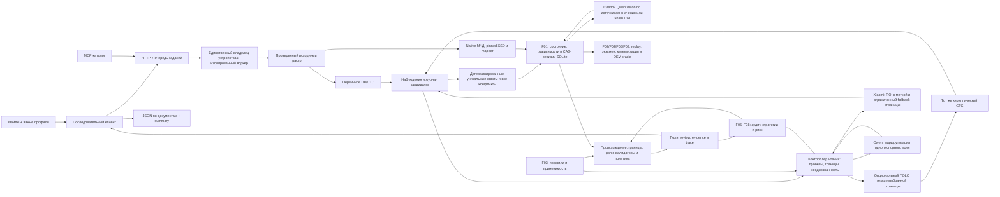

# Архитектура Харнесс OCR

Архитектура 0.1.0rc6 — одно ядро на Linux-узле и один последовательный владелец GPU. Ядро доступно через HTTP/MCP либо через отдельный поставочный GPU-прогон без сервиса. Растровые документы проходят адаптивный оптический тракт; зарегистрированная МЧД проходит структурный тракт без нейросетевых вызовов. Ограниченные CPU-результаты приведены в [rc5-quality-findings.md](rc5-quality-findings.md); они не квалифицируют CUDA/BF16, новые макеты или производственную точность.

## Поставочный GPU-контур RC6

`scripts/gpu_handoff.sh` запускает host-координатор на Python 3.12+ и standalone `compose.gpu-handoff.yaml`. Клиент передаёт явный профиль для папки либо manifest; автоматического определения типа документа нет. HTTP, MCP, токены сервиса и ручная установка библиотек моделей на хост не требуются. Документы и необязательный отдельный gold монтируются read-only, UID/GID владельца сохраняются, результаты сразу доступны на хосте.

```mermaid
flowchart LR
    Files[Файлы и явные профили] --> Host[Host launcher и новый каталог отчёта]
    Host --> Image[YOLO image build и pin фактического image ID]
    Image --> Lease[Общий lock volume и узкий root init]
    Lease --> Plan[Metadata plan: профили и скалярные ссылки без NN]
    Gold[Отдельный gold] --> Plan
    Plan --> Prepare[Явное скачивание закреплённых моделей и SHA verify]
    Prepare --> Doctor[Offline doctor и BF16 kernel]
    Doctor --> Smoke[Последовательный настоящий GPU smoke]
    Smoke --> Matrix[Матрица adaptive вариантов: новый worker на строку]
    Matrix --> Core[То же Engine и строгие проверки]
    Core --> Private[Приватные result, trace, protocol и ресурсы]
    Private --> Grade[Оценка только координатором после workers]
    Gold --> Grade
    Grade --> Export[Allowlist exporter]
    Host --> Export
    Export --> Public[RETURN_TO_TEAM.zip: HTML, CSV и безопасный JSON]
```

По умолчанию сравниваются Qwen 0.8B/4B × DB/DB+YOLO-L rescue — четыре варианта. Выбор одной Qwen оставляет два и не скачивает другую модель; X добавляет по одному варианту на выбранную Qwen. У каждого документа/варианта собственные state и Supervisor; финальные наблюдения и claims между вариантами не переиспользуются. Все варианты сохраняют Xiaomi, ограниченные чтения, visual verifier и валидаторы. Порядок и общие лимиты фиксируются до вычислений.

Общие caps GPU-протокола: CUDA/BF16, SDPA, 4 CPU threads, 32 768 входных и до 1024 выходных токенов, 300 с на вызов, 900 с на документ; до двух перечитываний, двух visual ROI, одного detector rescue и одного fallback страницы. На сравнение отдельно отведены 10 800 с; у build/download/smoke свои бюджеты. Это исследовательские пределы, а не обещание задержки. Незавершённые и не начатые из-за бюджета строки остаются видимыми; автоматических повторов нет.

CUDA/BF16 относится к Xiaomi и Qwen; YOLO выполняется на CUDA в FP32. DB и кириллический CTC используют ONNX Runtime на CPU. Растеризация, геометрия, валидация и координация также остаются CPU-работой. Поэтому измеряются отдельно полный путь, нейронные вызовы, RAM и VRAM; наличие GPU не означает одинаковый коэффициент ускорения всех стадий.

Внешний volume `harness-ocr-device-locks` используется и API, и batch-контейнерами. В них он может монтироваться по разным путям: общими должны быть сам volume и inode lease-файлов. Root init без GPU/сети подготавливает только пять фиксированных файлов без удаления или подмены. `gpu-delivery.lock` охраняет весь smoke/сравнение, admission/compute leases — отдельного владельца. Запущенный OCR на пересекающейся либо неопределённой GPU требует ручной остановки; launcher её не выполняет. Подробности — [deployment-readiness.md](deployment-readiness.md).

Только временный `measured` service для smoke/сравнения использует host PID namespace: NVML PID сопоставляются с собственным деревом процессов. Основной API и остальные стадии его не используют. Неизвестный VRAM сохраняется неизвестным; sampled NVML и PyTorch allocated/reserved — разные измерения.

Gold v1 содержит только отдельные дословные скалярные строки. Coordinator проверяет schema/IDs/subset до скачивания весов и считает качество после закрытия workers; значения и путь gold не передаются в inference specs или model prompts. Без gold измеряются выполнение, охват и ресурсы, а точность остаётся неизмеренной. Typed-поля требуют отдельного протокола оценки. Техническое завершение и `review` совместимы; закрытая квалификация автоматического принятия не меняется.

Публичный `RETURN_TO_TEAM.zip` содержит `report.html`, `metrics.csv`, `summary-public.json` (`harness-gpu-return/1`) и `manifest.json` с SHA (`harness-gpu-return-manifest/1`). Exporter вызывается также после ошибок и пропускает только разрешённые counts, hashes и resources. Приватные `handoff-status.json`, `doctor.json`, `smoke/report.json`, `comparison/{summary,status,protocol}.json`, rows/state/logs и `private-input-map.json` остаются на хосте; всю папку не следует считать возвратным архивом. Последовательность — [delivery-sequence.mmd](delivery-sequence.mmd).

## Контур HTTP/MCP и компоненты ядра

Для уже развёрнутого сервиса остаётся `scripts/run_documents.py`: локальный manifest с явными профилями, последовательные HTTP-задания и сохранение result/trace/status со сводкой. Клиент не владеет моделями; ими владеет единственный сервис. Это отдельный операторский путь, для которого настраиваются токены, UID/GID и права существующих state/report volumes. Gold не требуется для инференса. Внутреннее ядро и его взаимодействия ниже сохраняются и в GPU delivery.

F01–F09 работают через общее состояние и контракты; инструменты исследовательского контура вызываются отдельно. Внешние интеграции не входят в обязательный поставочный путь.

## Получение и выполнение задания

HTTP принимает файл с ограничением размера и возвращает непрозрачный идентификатор артефакта. Задание связывает этот идентификатор с профилем и допустимым набором полей. После проверки моделей единственный scheduler атомарно переводит задание из очереди в выполнение.

Распаковка PDF/изображений и модельные операции выполняются в изолированном процессе с жёстким deadline. Общая блокировка устройства состоит из допуска родителя и compute-lease воркера: авария родителя не разрешает второму процессу считать устройство свободным, пока старый воркер ещё работает.

## Наблюдения и выбор кандидатов

В режиме `adaptive` первичный DB определяет области текста; CTC читает кириллицу и сохраняет геометрию. Пустая или частично прочитанная область остаётся доступной для адресного чтения. Оценки CTC остаются диагностикой, а не вероятностью правильности поля. Чтение каждой полной страницы Xiaomi больше не является обязательным первым шагом. Контекстный bbox вырезается из исходного upright-растра без автоматического поворота. Выпрямление и поворот вертикальной текстовой строки применяется только к детекторным строкам; это другой тип области. Созданный контекстный crop не может стать собственным основанием следующего перечитывания.

Сборщик создаёт буквальные кандидаты, связи с метками и ограниченный граф соседства. Он учитывает полные границы значения, источник, страницу, метку роли и допустимую связь фрагментов. Наблюдения добавляются без переписывания предыдущих, версии кандидатов сохраняются в трассе. Пока доступны ограниченные чтения, короткий фрагмент не фиксируется преждевременно как полное поле. Итоговый журнал формирует утверждения после завершения этих чтений.

Для единственного полного значения с допустимым доказательством роли используется детерминированный выбор существующего кандидата. Уникальность не означает правильность OCR, валидность реквизита или право на автоматическое принятие. Qwen нужен для маршрутизации подлинной неоднозначности: не более двух окон полей, одно поле на запрос, ограниченные наблюдения, геометрия и разрешённые ID. Он может предложить область чтения, но не назначить истину голосованием и не удалить противоречие. В режиме `rules` такого обращения к selector нет; оптические чтения и проверки сохраняются.

Закрытая схема Qwen формируется сервером. Помимо JSON-синтаксиса ограничитель запрещает повтор поля и выход за allowlist; для визуального `unreadable` допустим только пустой литерал. Невалидный или незавершённый ответ не вызывает перехода к свободной генерации. Проверка на сервере заново устанавливает существование ID, буквальную поддержку и роль. Выдуманные значения и объединение различающихся цифр отклоняются.

Различающиеся чтения с подтверждённой ролью поступают в граф конфликтов независимо от предпочтения Qwen. Совпавшие чтения могут объединить ссылки на источники, но не считаются независимыми статистическими свидетельствами.

Роль нельзя вывести из одной длины или формата строки. В частности, для номера паспорта без печатной метки требуется квалифицированный адаптер соответствующего макета или другое доверенное доказательство роли. Успешное распознавание боковых цифр само по себе не закрывает это поле. Такая граница отражается в `review`, а не обходится догадкой модели.

## Типизированные значения

Семь составных полей D04/D05/D06/D07/D10 используют вложенные контракты `typed-fields-v1`: идентификаторы сторон и техники, счета получателя, строки истории собственности и номер полиса ОМС. Значение передаётся объектом, а не строкой с сериализованным JSON. Каждый элемент сохраняет исходное значение, вид, версию, роль и собственные spans; списки сохраняют порядок и допустимые повторы.

В растровом тракте вид и роль подтверждают явные метки и поддерживаемая структура строки или таблицы. Длина числа сама по себе не определяет его вид. Сервер повторно восстанавливает составное значение из активных завершённых наблюдений при записи утверждения, валидации и оценке риска. Пропуск, перестановка, выдуманная роль и смешение строк не наследуют доказательство исходного списка.

Исполняемый контракт не означает знание всех редакций документа. Неизвестная версия, неоднозначная структура и несколько разных значений одного вида требуют review. PIN и заводской номер сохраняются буквально; ограниченный зарегистрированный контекст Deere 331G/333G позволяет отдельные проверки, неизвестные изготовители и общий заводской номер сохраняют `not_checked`. Банковский ключ проверяется только по полной ячейке БИК и доказанному месту открытия счёта; неизвестный контекст не подбирается по проходящей формуле. Точные границы приведены в [identifier-validation.md](identifier-validation.md). Границы полей приведены в [матрице готовности](readiness.md).

Финальная проекция отдельно проверяет ограниченную неопределённость имён: похожие латинские и кириллические буквы внутри одного слова либо превышение бюджета этой проверки требуют review. Исходные строки и бизнес-валидация не меняются. Обязательное поле с таким сигналом не считается полностью закрытым, даже если формат прошёл проверку. Сигнал применяется после нейромоделей и не исправляет номера или неверное чтение verifier.

## Native МЧД

Для D04 зарегистрирован `fns-emchd-003-v1`: единый003 / `EMCHD_1`, namespace `urn://x-artefacts/EMCHD_1`. Полный XML проверяется оригинальным опубликованным XSD с зафиксированным SHA256. Разрешён обычный ненотариальный B2B-вариант: `ПрЭлФорм="00000000"`, `Документ/Довер`, `СвДов/@ВидДовер="1"`. Другие версии, флаги, передоверие, нотариальный вариант и подписанные контейнеры отклоняются явно.

Mapper использует точные namespace, пути и атрибуты и проверяет соответствие типа стороны её структурной ветке. Все четыре типа доверителя и пять типов представителя имеют явные отображения. Руководитель организации не становится представителем по совпадению имени или ИНН; атрибуты не превращаются в выдуманные текстовые метки.

Родитель повторяет адаптер над собственным исходным артефактом. `DocumentStore` в одной ревизии сохраняет проверенную native-сводку и наблюдения; пакетный реестр проверенного результата позволяет сверять наблюдения без повторного чтения XML для каждого атрибута. Структурные утверждения сохраняются следующей ревизией. Все стороны, ограничения и флаги доверия доступны при последующей проекции и аварийном восстановлении.

Множественные стороны остаются упорядоченными структурированными списками; скалярный D04 не выбирает первую сторону. Машинные полномочия сохраняют коды, названия и все ограничения; `authority_literal` не подменяется одним названием. Такие случаи требуют структурированного контракта услуги и review. Generic XML остаётся отдельной диагностикой без native- или raster-квалификации.

DTD, сущности, внешние ресурсы, XInclude, динамические схемы и XMLDSig-конверты не допускаются. XSD подтверждает структуру: подпись, доверие подписанту, отзыв, текущая действительность и достаточность полномочий остаются `not_verified`. Источники и точное отображение: [mchd_native.md](mchd_native.md).

## Перечитывание и завершение

Контроллер работает по пробелам в доказательствах и ограничивает каждую ветвь. По умолчанию предусмотрены до двух Xiaomi-перечитываний ROI с контекстом метки, до одного дополнительного детектора выбранной страницы и до одного fallback-чтения полной страницы на документ. Это верхние границы, а не обязательное число обращений. Одинаковая ROI не перечитывается повторно. При оборванной границе дополнительный детектор может вызываться раньше ROI-чтения; в остальных случаях контроллер сначала использует адресные области. Полная страница — последний ограниченный источник после адресных попыток.

Дополнительный детектор выключен по умолчанию. Если включён YOLO-L, он обрабатывает только выбранную страницу с незакрытыми полями, сохраняет собственную геометрию, а текст читает прежний CTC. Поэтому DB+CTC и YOLO+CTC нельзя объявлять независимыми читателями. Новые наблюдения дополняют журнал; детектор не устанавливает семантическую роль и не подменяет Xiaomi, Qwen или валидаторы.

Незавершённый ответ модели сохраняется как частичный результат. Ошибка отдельного чтения, неизвестная локализация и неисполненный критический запрос остаются видимыми и блокируют автоматическое принятие; они не исчезают после исчерпания бюджета. Корректно прочитанный, но невалидный ИНН или календарная дата сохраняются буквально с отказом проверки, без исправления цифр.

После выбора и перечитываний опциональный `visual_read` передаёт Qwen проверенные пиксели ROI без кандидата, ожидаемого значения и gold. Сервер связывает исходный файл, растр и crop по SHA и фактическим пикселям, сохраняет геометрию, предобработку и хеши тензоров. План строится по spans самого значения, а не по всем сопутствующим evidence IDs.

Для одного локализованного источника новый capture сравнивается с полным текстом исходного наблюдения. Если значение состоит из нескольких полных исходных наблюдений одной горизонтальной строки на одной странице, сервер может построить одну настоящую union ROI и сравнить упорядоченное соединение всех фрагментов. Символьные offsets не превращаются в пиксельные координаты: частичный span строки не даёт права вырезать предполагаемые символы. Для него проверяется исходная область целиком. Вертикальные компоненты имени проверяются раздельно: переносы строк слепого чтения не сравниваются с пробелами сборки как ложный конфликт.

Чтение полной страницы, которое только подтверждает уже локализованное значение, сохраняется как вспомогательное evidence и не расходует слепую проверку на всю страницу. Если же сама доказательная цепочка значения опирается только на нелокализованное чтение полной страницы, охват неполон и требуется review. Ролевые источники отдельно учитываются и не объявляются проверенными по сходству текста.

Расхождение и воздержание сохраняются в графе и переживают повторную проекцию. План включает все растровые источники spans всех живых утверждений значения. Бюджет считается по уникальным серверным дескрипторам реальных ROI, а не по количеству слов. Один неизменяемый capture может использоваться повторно для одной и той же области; каждое исходное чтение проверяется отдельно. Недоступные области, противоречия и исчерпанный бюджет сохраняют review. Повтор capture не создаёт независимых свидетельств. Совпадение литерала не доказывает роль, полноту документа или право на автозаполнение.

В Compose проверка включена по умолчанию через `HARNESS_VISUAL_VERIFIER=1`. Программный `Settings.visual_verifier` и окружение без этой переменной имеют значение `False`. CLI `infer` наследует переключатель из окружения так же, как HTTP; парный benchmark выключает vision явно. По умолчанию разрешены две уникальные ROI; допустимый серверный диапазон — одна–четыре. Проверка всей страницы и всех полей не обещается; Qwen text и Qwen vision не объявляются независимыми читателями.

После терминального перехода задания сервис заново проверяет актуальную серверную политику. Отмена, отзыв политики, карантин, изменение кода/моделей/лимитов/стратегий или неизвестная применимость не наследуют старое разрешение на автозаполнение. Действия услуги — отдельный контур: OCR не подтверждает оплату и не выдаёт право на услугу.

## Состояние и трассы

`DocumentStore` хранит неизменяемые наблюдения, scalar/typed утверждения, native-сводку, визуальные сравнения, зависимости и атомарные ревизии. Отзыв источника распространяется на зависимые выводы. После разрешения противоречия старое автоматическое утверждение не восстанавливается молча: требуется новое доказательство или авторизованная правка.

`JobStore` хранит очередь и терминальные состояния. После аварии незавершённое выполнение становится `interrupted`, а сохранённые наблюдения доступны без повторного запуска модели. `TraceRecorder` хранит входы/выходы стадий, конфигурацию и хеши; детерминированный replay не вызывает нейромодель.

Правка оператора требует отдельного полномочия и CAS-ревизии. Она сохраняется как человеческое решение; машинная оценка риска не квалифицирует автоматически новый человеческий литерал.

## Профили и контроль качества

Одна декларация компилируется в схему ответа, контракт выбора кандидатов, настройки валидаторов, review и MCP-проекцию. `contract_result` соответствует скомпилированной JSONSchema; расширенные evidence и трассы находятся рядом.

Условия полей задаёт доверенная серверная конфигурация для точного профиля, версии и области входов. Отсутствие конфигурации не превращает условие в `false`. Новая конфигурация меняет binding и требует соответствующей квалификации.

F06–F08 работают после публикации результата: выборочный аудит хранит вероятность отбора; дрейф может включить карантин; политика риска применяется только в активном состоянии и к точному binding. По умолчанию квалифицированных production-политик нет.

F04 содержит текстовый экзамен и отдельный визуальный экзамен над проверенными пикселями; приватные метки остаются у scorer. F05 минимизирует воспроизводимый дефект трассы, F09 выполняет DEV-вмешательства в selector. Они не передают gold в пользовательский инференс и не выполняют самообучение по правкам оператора.

Прежний парный A0/A1/A3/A4 benchmark запускается с явными `--reading-policy legacy --rescue-text-detector none`, замораживает начальные растровые наблюдения и учитывает стоимость перечитываний отдельно. Он выключает visual verifier для сопоставимости ветвей и отклоняет native XML до проверки моделей: МЧД без OCR требует собственного структурного испытания. Визуальный F04 — отдельный протокол. Измерение нового адаптивного тракта требует отдельной заморозки политики, лимитов и порядка парных ветвей.

## Ограничения соответствия

Матрица [готовности](readiness.md) отделяет исполнение от доказанного качества. Десять деклараций и исполняемые контракты не означают квалифицированного покрытия всех их макетов или 30–50 типов документов. Целевые GPU BF16, реальные размеченные оригиналы, прикладной риск, доверенные реестры и криптографические проверки требуют отдельных доказательств. Действия услуги остаются вне OCR.

Диаграмма HTTP/ядра: [sequence.mmd](sequence.mmd). Отдельный GPU delivery: [delivery-sequence.mmd](delivery-sequence.mmd).

## Настройки чтения и экспериментальная локализация YOLO26-Text

`HARNESS_READING_POLICY` выбирает `adaptive` (по умолчанию) или `legacy`.
В legacy сохраняется прежний порядок с Xiaomi по каждой странице и полным
сравнением исходного наблюдения в визуальном verifier. Его результаты нельзя
смешивать с адаптивным трактом без явного парного протокола.

`HARNESS_TEXT_DETECTOR` выбирает `db` (по умолчанию), `yolo26l` или `yolo26x`.
`HARNESS_RESCUE_TEXT_DETECTOR` выбирает `none` (по умолчанию), `yolo26l` или
`yolo26x`; дополнительный детектор должен отличаться от основного и работает
только в adaptive. YOLO работает внутри
того же единственного Supervisor-владельца моделей. SHA весов проверяется до
загрузки, сеть и автоматическая установка зависимостей выключены.

YOLO возвращает слова в координатах исходного растра. Геометрическая сборка
формирует строки, сохраняя исходные word quads/IDs; неоднозначная сборка,
обрезание или исчерпание лимита делают оптический результат неполным. Затем
используются прежний кириллический CTC и наш `rectify_quad` с хешами и обратным
преобразованием координат. Готовый OCR-wrapper с PP-OCRv6 не используется.

Xiaomi, адресная маршрутизация Qwen, лимиты перечитывания и визуального verifier,
типизированные валидаторы и политика допуска сохраняются. Пустая при первом
CTC-чтении область регистрируется для визуального контроля сразу: успешное
перечитывание не теряет проверку исходных пикселей. Native МЧД проходит свой
структурный маршрут без YOLO/OCR. Смена детектора и группировки меняет binding
и не наследует прежнюю квалификацию допуска.

В Docker опциональная зависимость устанавливается только при сборке с
`HARNESS_INSTALL_YOLO=1`. При подготовке моделей требуется явно добавить
`yolo26l-text` либо `yolo26x-text` к `prepare-models --only`; обычный список
моделей эти веса не скачивает. В CLI `infer`/`bench` предусмотрены
`--reading-policy`, `--rescue-text-detector`, `--max-detector-rescues` и
`--max-whole-page-reads`. Settings, Compose и CLI сохраняют выбранные значения
в runtime binding. Пример Linux/Docker приведён в [README](../README.md).

Отдельный [протокол сравнения](../experiments/yolo26/README.md) выполняет
собственную оптику каждого детектора и разделяет диагностику чтения `optics`
и полный `e2e` с одной и той же Qwen. Старый A0/A1/A3/A4 benchmark остаётся
DB-протоколом; его нельзя использовать для сравнения детекторов.
