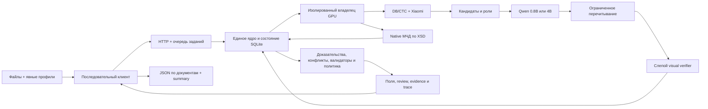

# Архитектура Харнесс OCR

Архитектура 0.1.0rc4 — один Linux-узел, один последовательный владелец GPU, HTTP-сервис и адаптер существующего MCP-каталога. Логические модули находятся в одном Python-пакете. Растровые документы проходят оптический тракт; зарегистрированная МЧД проходит отдельный структурный тракт без нейросетевых вызовов.

## Поставочный контур

Основной клиент передачи — `scripts/run_documents.py`: локальный manifest с файлами и явными профилями, предварительная проверка всех входов, последовательные задания через штатный HTTP и сохранение result/trace/status плюс сводка. Клиент не владеет моделями; ими по-прежнему владеет единственный сервис. Модель 0.8B или 4B задаётся на запуск. Gold не требуется для инференса; парный benchmark остаётся отдельным исследовательским инструментом.

F01–F09 работают через общее состояние и контракты; инструменты исследовательского контура вызываются отдельно. Внешние интеграции не входят в обязательный поставочный путь.

## Получение и выполнение задания

HTTP принимает файл с ограничением размера и возвращает непрозрачный идентификатор артефакта. Задание связывает этот идентификатор с профилем и допустимым набором полей. После проверки моделей единственный scheduler атомарно переводит задание из очереди в выполнение.

Распаковка PDF/изображений и модельные операции выполняются в изолированном процессе с жёстким deadline. Общая блокировка устройства состоит из допуска родителя и compute-lease воркера: авария родителя не разрешает второму процессу считать устройство свободным, пока старый воркер ещё работает.

## Наблюдения и выбор кандидатов

DB определяет области текста; CTC читает кириллицу и сохраняет геометрию. Xiaomi даёт дополнительное чтение страницы и выбранных областей. Оценки CTC остаются диагностикой, а не вероятностью правильности поля.

Сборщик создаёт буквальные кандидаты, связи с метками и ограниченный граф соседства. Qwen получает исходные наблюдения, геометрию, контракты и утверждённые стратегии; возвращает только ID кандидатов и разрешённых областей. Проверка на сервере устанавливает существование ID, буквальную поддержку и роль. Выдуманные значения и объединение различающихся цифр отклоняются.

Различающиеся чтения с подтверждённой ролью поступают в граф конфликтов независимо от предпочтения Qwen. Совпавшие чтения могут объединить ссылки на источники, но не считаются независимыми статистическими свидетельствами.

## Типизированные значения

Семь составных полей D04/D05/D06/D07/D10 используют вложенные контракты `typed-fields-v1`: идентификаторы сторон и техники, счета получателя, строки истории собственности и номер полиса ОМС. Значение передаётся объектом, а не строкой с сериализованным JSON. Каждый элемент сохраняет исходное значение, вид, версию, роль и собственные spans; списки сохраняют порядок и допустимые повторы.

В растровом тракте вид и роль подтверждают явные метки и поддерживаемая структура строки или таблицы. Длина числа сама по себе не определяет его вид. Сервер повторно восстанавливает составное значение из активных завершённых наблюдений при записи утверждения, валидации и оценке риска. Пропуск, перестановка, выдуманная роль и смешение строк не наследуют доказательство исходного списка.

Исполняемый контракт не означает знание всех редакций документа. Неизвестная версия, неоднозначная структура и несколько разных значений одного вида требуют review. PIN и заводской номер сохраняются буквально; ограниченный зарегистрированный контекст Deere 331G/333G позволяет отдельные проверки, неизвестные изготовители и общий заводской номер сохраняют `not_checked`. Банковский ключ проверяется только по полной ячейке БИК и доказанному месту открытия счёта; неизвестный контекст не подбирается по проходящей формуле. Точные границы приведены в [identifier-validation.md](identifier-validation.md). Границы полей приведены в [матрице готовности](readiness.md).

## Native МЧД

Для D04 зарегистрирован `fns-emchd-003-v1`: единый003 / `EMCHD_1`, namespace `urn://x-artefacts/EMCHD_1`. Полный XML проверяется оригинальным опубликованным XSD с зафиксированным SHA256. Разрешён обычный ненотариальный B2B-вариант: `ПрЭлФорм="00000000"`, `Документ/Довер`, `СвДов/@ВидДовер="1"`. Другие версии, флаги, передоверие, нотариальный вариант и подписанные контейнеры отклоняются явно.

Mapper использует точные namespace, пути и атрибуты и проверяет соответствие типа стороны её структурной ветке. Все четыре типа доверителя и пять типов представителя имеют явные отображения. Руководитель организации не становится представителем по совпадению имени или ИНН; атрибуты не превращаются в выдуманные текстовые метки.

Родитель повторяет адаптер над собственным исходным артефактом. `DocumentStore` в одной ревизии сохраняет проверенную native-сводку и наблюдения; пакетный реестр проверенного результата позволяет сверять наблюдения без повторного чтения XML для каждого атрибута. Структурные утверждения сохраняются следующей ревизией. Все стороны, ограничения и флаги доверия доступны при последующей проекции и аварийном восстановлении.

Множественные стороны остаются упорядоченными структурированными списками; скалярный D04 не выбирает первую сторону. Машинные полномочия сохраняют коды, названия и все ограничения; `authority_literal` не подменяется одним названием. Такие случаи требуют структурированного контракта услуги и review. Generic XML остаётся отдельной диагностикой без native- или raster-квалификации.

DTD, сущности, внешние ресурсы, XInclude, динамические схемы и XMLDSig-конверты не допускаются. XSD подтверждает структуру: подпись, доверие подписанту, отзыв, текущая действительность и достаточность полномочий остаются `not_verified`. Источники и точное отображение: [mchd_native.md](mchd_native.md).

## Перечитывание и завершение

Контроллер ограничивает число областей и раундов. Незавершённый ответ модели сохраняется как частичный результат. Неисполненный запрос критического перечитывания остаётся видимым и блокирует автоматическое принятие; он не исчезает после исчерпания бюджета.

После выбора и перечитываний опциональный `visual_read` передаёт Qwen проверенные пиксели ROI без кандидата, ожидаемого значения и gold. Сервер связывает исходный файл, растр и crop по SHA и фактическим пикселям, сохраняет геометрию, предобработку и хеши тензоров. Новый capture сравнивается с полным текстом исходного наблюдения точным детерминированным правилом.

Расхождение и воздержание сохраняются в графе и переживают повторную проекцию. Планировщик собирает все evidence IDs живых утверждений, включая новые чтения. Бюджет считается по SHA уникальных серверных дескрипторов ROI. Для нескольких наблюдений одной и той же ROI один неизменяемый capture используется повторно, но каждое полное исходное чтение сравнивается отдельно. Полная visual coverage поля требует проверки всех его растровых support-наблюдений; недоступные области и исчерпанный бюджет оставляют поле в review. Повторное использование capture не создаёт независимых свидетельств. Совпадение литерала не доказывает роль и не разрешает автозаполнение.

В Compose проверка включена по умолчанию через `HARNESS_VISUAL_VERIFIER=1`. Программный `Settings.visual_verifier` и окружение без этой переменной имеют значение `False`. CLI `infer` наследует переключатель из окружения так же, как HTTP; парный benchmark выключает vision явно. По умолчанию разрешены две уникальные ROI; допустимый серверный диапазон — одна–четыре. Проверка всей страницы и всех полей не обещается; Qwen text и Qwen vision не объявляются независимыми читателями.

После терминального перехода задания сервис заново проверяет актуальную серверную политику. Отмена, отзыв политики, карантин, изменение кода/моделей/лимитов/стратегий или неизвестная применимость не наследуют старое разрешение на автозаполнение. Действия услуги — отдельный контур: OCR не подтверждает оплату и не выдаёт право на услугу.

## Состояние и трассы

`DocumentStore` хранит неизменяемые наблюдения, scalar/typed утверждения, native-сводку, визуальные сравнения, зависимости и атомарные ревизии. Отзыв источника распространяется на зависимые выводы. После разрешения противоречия старое автоматическое утверждение не восстанавливается молча: требуется новое доказательство или авторизованная правка.

`JobStore` хранит очередь и терминальные состояния. После аварии незавершённое выполнение становится `interrupted`, а сохранённые наблюдения доступны без повторного запуска модели. `TraceRecorder` хранит входы/выходы стадий, конфигурацию и хеши; детерминированный replay не вызывает нейромодель.

Правка оператора требует отдельного полномочия и CAS-ревизии. Она сохраняется как человеческое решение; машинная оценка риска не квалифицирует автоматически новый человеческий литерал.

## Профили и контроль качества

Одна декларация компилируется в схему ответа, контракт выбора кандидатов, настройки валидаторов, review и MCP-проекцию. `contract_result` соответствует скомпилированной JSONSchema; расширенные evidence и трассы находятся рядом.

Условия полей задаёт доверенная серверная конфигурация для точного профиля, версии и области входов. Отсутствие конфигурации не превращает условие в `false`. Новая конфигурация меняет binding и требует соответствующей квалификации.

F06–F08 работают после публикации результата: выборочный аудит хранит вероятность отбора; дрейф может включить карантин; политика риска применяется только в активном состоянии и к точному binding. По умолчанию квалифицированных production-политик нет.

F04 содержит текстовый экзамен и отдельный визуальный экзамен над проверенными пикселями; приватные метки остаются у scorer. F05 минимизирует воспроизводимый дефект трассы, F09 выполняет DEV-вмешательства в selector. Они не передают gold в пользовательский инференс и не выполняют самообучение по правкам оператора.

Парный A0/A1/A3/A4 benchmark замораживает начальные растровые наблюдения и учитывает стоимость перечитываний отдельно. Он выключает visual verifier для сопоставимости ветвей и отклоняет native XML до проверки моделей: МЧД без OCR требует собственного структурного испытания. Визуальный F04 — отдельный протокол.

## Ограничения соответствия

Матрица [готовности](readiness.md) отделяет исполнение от доказанного качества. Десять деклараций и исполняемые контракты не означают квалифицированного покрытия всех их макетов или 30–50 типов документов. Целевые GPU BF16, реальные размеченные оригиналы, прикладной риск, доверенные реестры и криптографические проверки требуют отдельных доказательств. Действия услуги остаются вне OCR.

Диаграмма выполнения: [sequence.mmd](sequence.mmd).
